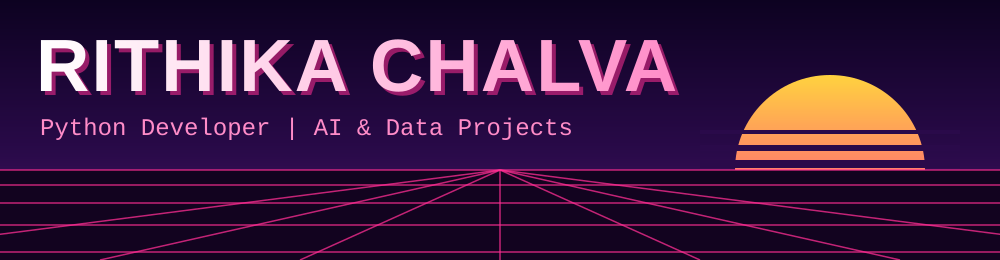

<h2 align="center">Hey there, I'm Rithika 👋</h2>

  
  

  

## 🌸 About Me
- 💻 Developer building AI and data-driven projects in Python
- 🔭 Currently working on **SentXStock** and **VaayuDrishti**
- 🏥 Built ML models for **patient length-of-stay and cost prediction**
- 🌱 Learning RAG, NLP and building real-world ML apps
- 📫 Reach me through the links below

## 🛠️ Tech Stack

## 🌐 Let's Connect

## 📊 GitHub Stats

  
  

## 🐍 Contribution Snake

  

<i>See you in the next commit 💖</i>

